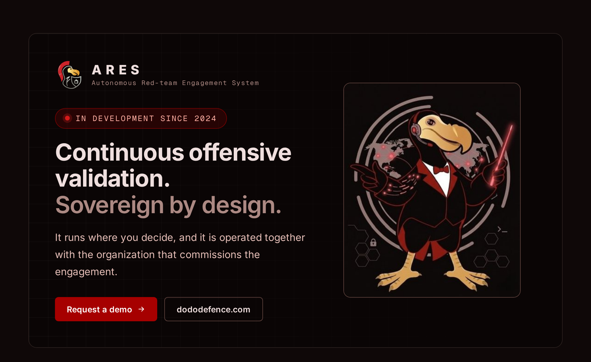
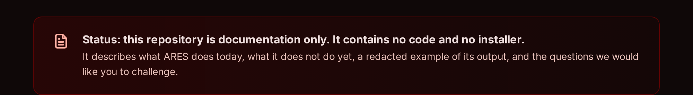
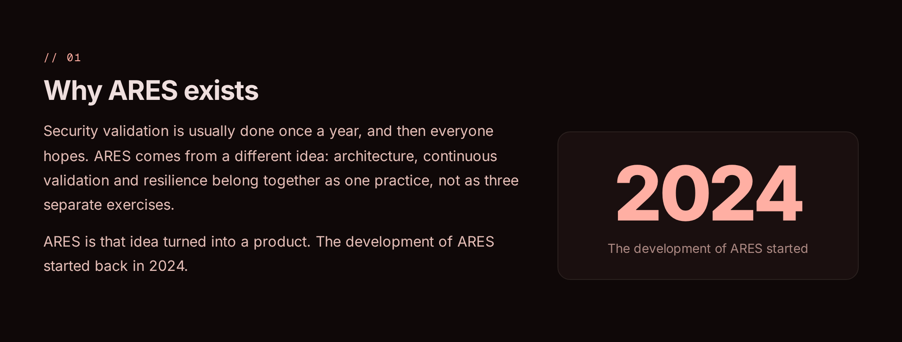
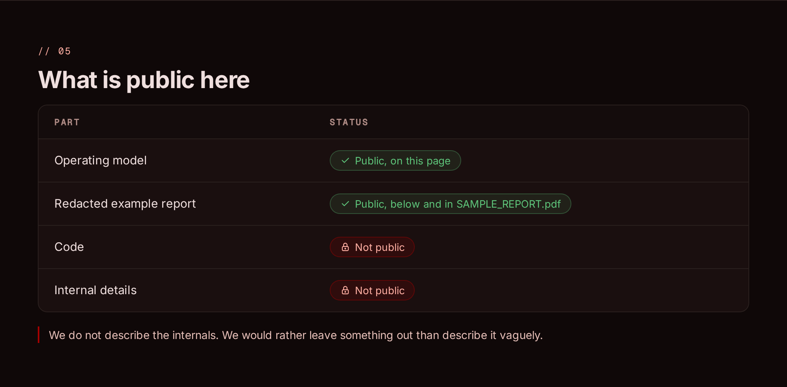
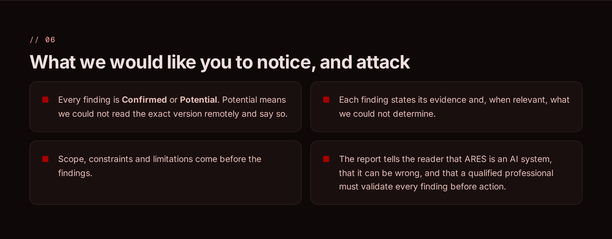
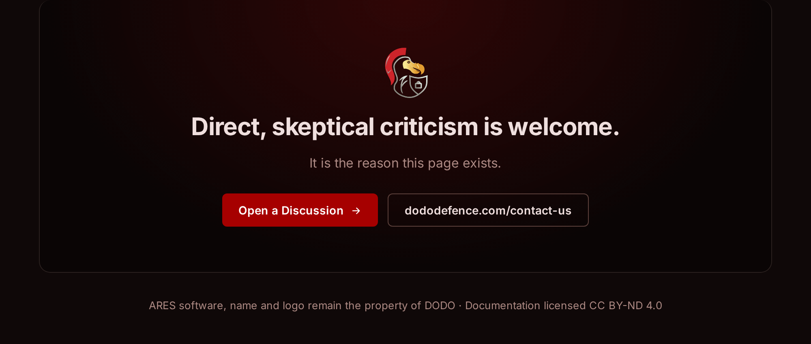

## How to respond

- Open a **Discussion** in this repository. It is the main channel.
- To propose a change to the report format, open an **Issue** with your own example of a finding.
- To write privately: https://dododefence.com/contact-us/

Direct, skeptical criticism is welcome. It is the reason this page exists.

## Example report

The full redacted vulnerability assessment, as ARES renders it: [**SAMPLE_REPORT.pdf**](SAMPLE_REPORT.pdf).

## What you will not find here

No descriptions of offensive techniques, no attack chains, no details about internal tooling or models. If a document here seems to go in that direction, please tell us.

## License and contact

The documentation in this repository, including the sample report, is licensed under [Creative Commons Attribution-NoDerivatives 4.0 International (CC BY-ND 4.0)](https://creativecommons.org/licenses/by-nd/4.0/). The ARES software, name and logo are not covered by this license and remain the property of DODO.

Product information, demos and commercial contact: https://dododefence.com
